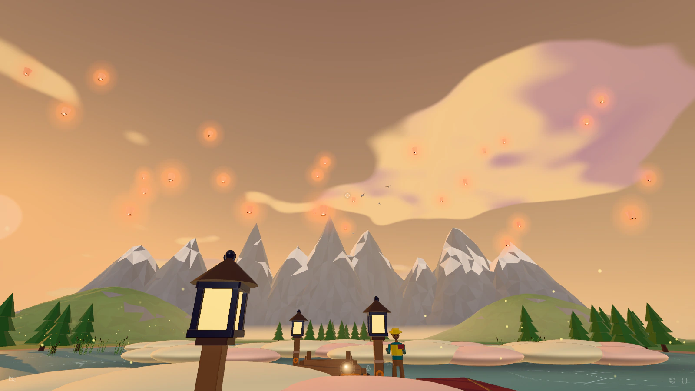
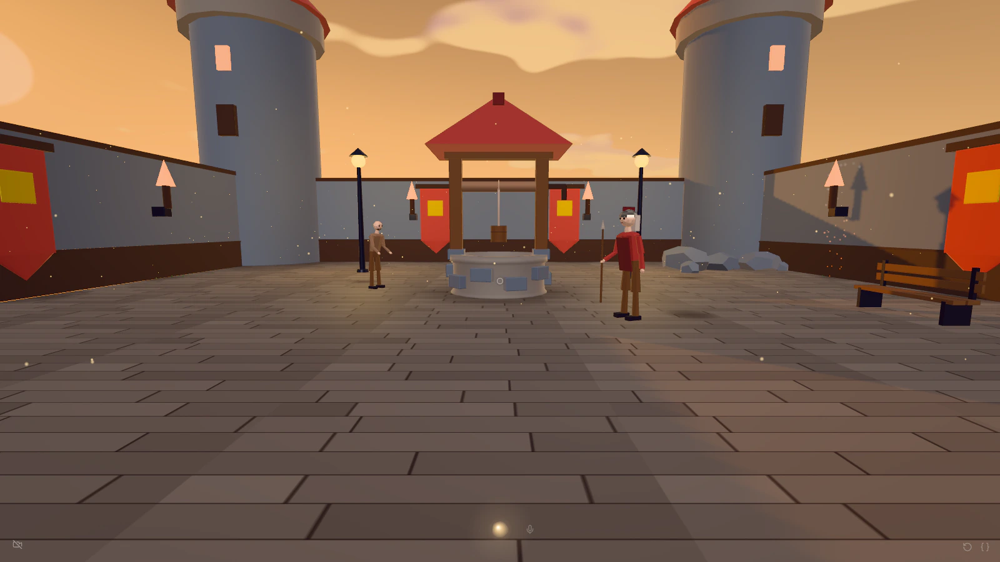
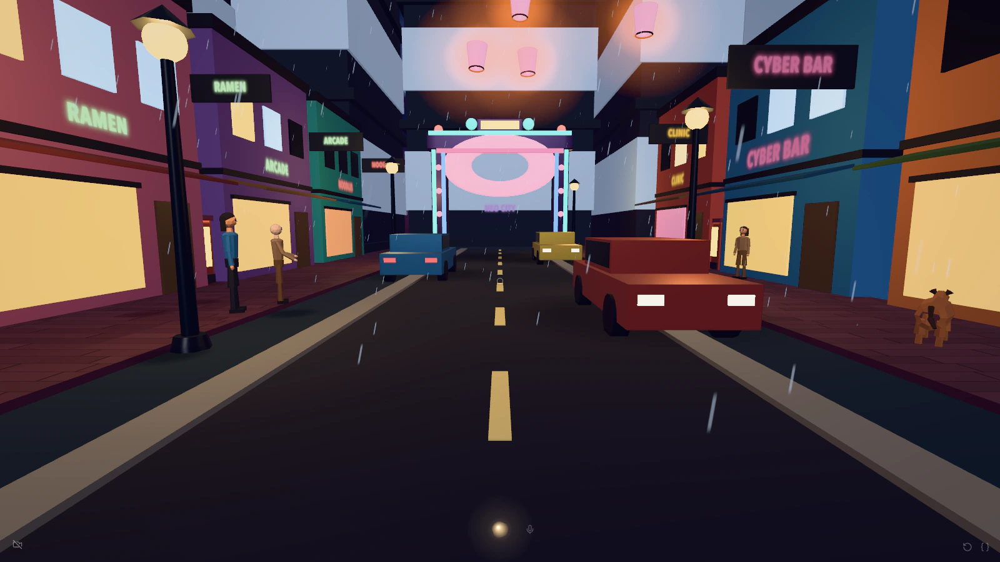
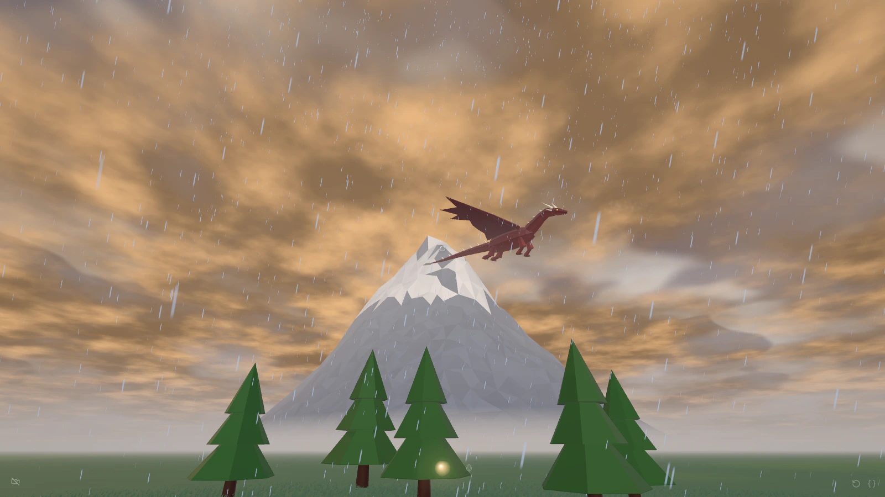
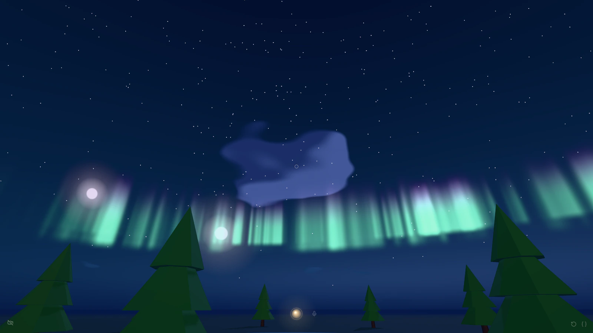
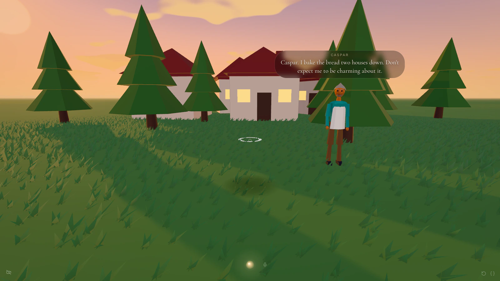
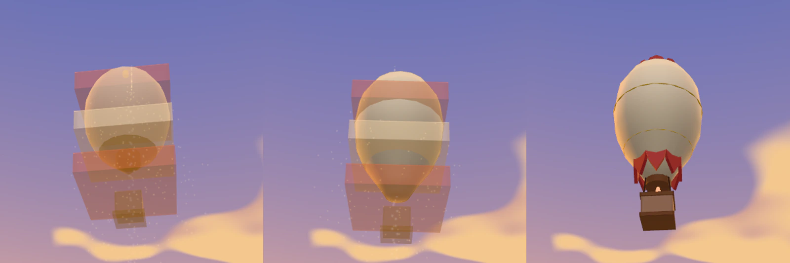

# Voice World

A first-person 3D world in the browser that you change by talking to it.



Say "put a castle on that hill", "make it a stormy night" or "take me to a neon city street", and the world
changes around you in a painted, toy-like style. Nothing is pre-built per scene: every place in the
screenshots below came from one or two spoken sentences.

## Try it

You need Node 22+, desktop Chrome, and your own [Vercel AI Gateway](https://vercel.com/ai-gateway) API key.
Every model call (voice, intent, scene building, people, object generation) goes through that one key.

```bash
git clone https://github.com/GKjohns/voice-world.git
cd voice-world
npm install                # if npm 10 crashes (arborist bug), use: npx npm@11 install
cp .env.example .env       # then set AI_GATEWAY_API_KEY
npm run dev                # http://localhost:3091
```

Allow the microphone when asked, or type instead (press Enter or `/`). A webcam is optional: turn on head
tracking to look and point hands-free.

## How it works

```
voice / text ──► intent (Haiku) ──► flat ops ──► kernel (pure, deterministic) ──► three.js renderer
                    │                                 ▲
                    ├── "take me to X" ──► Director (Sonnet) streams a whole scene as ops
                    └── unknown kind ──► forge: draft now, refine/polish/judge in the background
```

1. **Voice.** A realtime voice assistant (the "genie", `openai/gpt-realtime-mini`) listens and hands each
   request to one of two tools: build something here, or teleport somewhere new.
2. **Intent.** A fast model (Claude Haiku) turns the sentence into a few flat world operations such as
   `spawn`, `modify`, `move`, `remove`, `undo` or `atmosphere`. Models never do coordinate math; they pick
   things by set selectors and arrangements.
3. **Kernel.** A pure, deterministic kernel applies the ops to the world state, and three.js renders it.
   The op log is the world: replaying it rebuilds the same scene, which is how undo, save and reload work.
4. **Director and forge.** "Take me to X" goes to a larger model (Claude Sonnet) that streams a whole scene
   as ops. Objects outside the built-in kit are generated by the forge: a rough draft in about a second,
   then a detailed version that replaces it.

The model-by-role table, a file-level code map, and the test and benchmark scripts are in
[docs/development.md](docs/development.md).

## What you can do

| You say | What happens |
|---|---|
| "Put a bunch of pine trees over there." / "Make them all red." / "Undo that." | Spawn things one at a time or by the dozen, then change, move, recolour or remove them as a group. |
| "Take me to a medieval castle courtyard." | Teleport: the world is replaced by a newly built place, streamed in as the model writes it. |
| "Make it night with the northern lights and two moons." | Time of day, fog, rain, snow, storms, lightning, aurora, meteors, eclipses. |
| "A dragon circling the mountain." / "A whale swimming through the sky." | Creatures that fly, circle, gallop or follow you. |
| "Put a baker right in front of me." Then: "Hello, who are you?" | People with a persona, a routine, their own voice, and memory of what you told them (it survives a reload). |
| "A vintage hot air balloon floating in front of me." | Anything not in the built-in kit is forged: a draft in about a second, then a detailed version that replaces it. |
| "Let me fly." / "Make me tiny." / "Start over." | Movement and scale powers, and a clean reset. |

## Screenshots

All captured headless at 1600×900 from the current build. Each caption is the sentence that made the scene.

| | |
|---|---|
|  |  |
| "Take me to a medieval castle courtyard." | "Take me to a neon city street at night." |
|  |  |
| "A dragon circling over there", then "make it a stormy evening with lightning." | "Make it night with the northern lights and two moons." |
|  |  |
| A baker answers "hello! who are you?" in his own voice. | The forge: draft, gold ghost while the detailed version grows through it, final. |

## Controls

- **WASD / arrows** walk, **Shift** runs, **drag** to look (double-click locks the mouse).
- **Flying** (once you've asked to fly): **Space** / PageUp rises, **Shift+Space** / PageDown sinks.
- **Enter** or **/** opens the text field, **Esc** closes it, **Cmd/Ctrl+Z** undoes.
- Face a person and talk to them; start with "Genie, ..." to talk to the genie instead.
- **Backtick (`)** toggles the developer HUD: status, op log, model toggle and raw-op console.
- The **reset** button (corner icon) starts the world over; undo right after brings it back.
- The **flame** button (corner icon) turns on **Fresh** mode, or open `http://localhost:3091/?fresh=1` (`?fresh=0`
  forces it off; the URL wins over the remembered choice). With Fresh on, anything you name is designed live:
  no built-in kit creature or prop, no forged object from the library, and nothing is saved to the library.
  "A whale" gets a draft in a few seconds and its detailed version about 10 s later instead of the kit whale.
  Scenery stays on the kit (terrain, floors and walls, water, trees, rocks, people). Off by default.

The world saves to localStorage, and the developer console can export and import it as JSON.

## Cost

- A plain edit ("make them red") on Haiku: a fraction of a cent.
- A teleport (Director build): about 3 to 5¢.
- A forged novel object: about 3 to 6¢ (a detailed "hero" object about 13¢). Anything already in the local
  library is free, so the second dragon costs nothing.
- Realtime voice is billed per minute while the mic is open.

The forge enforces spend caps in `server/utils/forgeLedger.ts`: $12 total across sessions and $1.50 per
session, tracked in `.data/forge/ledger.jsonl`. The Director, intent, people and realtime voice have no caps,
so set a budget on the key in the Vercel dashboard as well.

## Status and limitations

Experimental. This is a personal research project, built quickly with a lot of AI help.

- Desktop Chrome only; no mobile or VR controls.
- Single player. The world, people's memories and the forge library live in your browser and in `.data/`.
- Model output varies: the same sentence can build a different place twice, and forged objects are sometimes
  odd (parts that float, proportions that are off). "Undo that" and "start over" are the escape hatches.

## License

MIT. See `LICENSE`.
